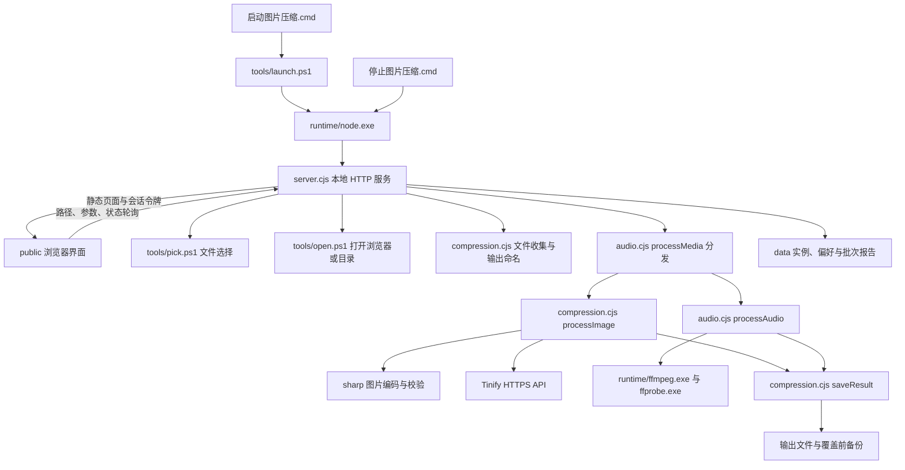
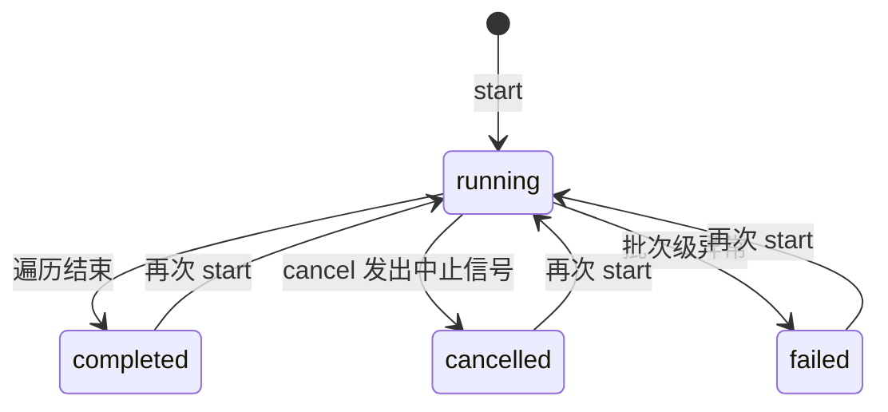

# 图片与音频压缩工具架构

本文描述 `package.json` 版本 0.1.4 的实际实现，面向后续开发和维护。使用操作见 [使用说明](使用说明.md)，构建和发布见 [README](README.md)，运行组件来源与许可证见 [第三方组件](第三方组件.md)。

## 1. 系统定位与运行环境

应用是 Windows x64 本地批量媒体压缩工具，支持 PNG/JPG/JPEG 和 MP3/OGG/WAV。用户通过浏览器操作本地文件路径，Node.js 服务直接读取和保存磁盘文件。默认覆盖原文件并保留备份，也支持按批次另存。

界面采用原生 HTML/CSS/JavaScript，无前端构建步骤；服务端采用 CommonJS 和 Node.js 内置 HTTP 模块，无 Web 框架或数据库。图片使用 sharp，音频通过子进程调用随工具分发的 FFmpeg/FFprobe。只有选择 Tinify 图片模式时需要访问外部服务。

随包运行环境为 Node.js 22.17.1，包声明 Node.js >=20；源码使用 `fetch`、`AbortSignal.timeout`、`AbortSignal.any` 等 API，替换运行环境时需验证这些能力。Windows 文件选择器依赖 PowerShell 和 Windows Forms。项目运行时不依赖 Cocos 编辑器。

## 2. 模块关系

桌面版由 `desktop/main.cjs` 创建 Electron 窗口，在主进程内调用 `createApp()` 启动本地服务，加载同一套前端。浏览器版继续由启动脚本运行 `server.cjs`。两种入口共用压缩、队列和报告实现。



| 文件或目录 | 职责 |
| --- | --- |
| `desktop/main.cjs` | Electron 生命周期、单实例、独立窗口、原生选择器、目录打开和退出时取消清理 |
| `desktop/smoke.cjs` | 打包程序自身的实际页面、混合压缩、报告下载和备份测试入口 |
| `build/` | electron-builder 配置和应用图标 |
| `vendor/` | Windows x64 构建依赖分卷、SHA-256 清单和解压工具 |
| `.github/workflows/build-windows.yml` | 仅版本标签触发的构建、测试和 Release 上传 |
| `server.cjs` | 服务启动与复用、路由、访问校验、文件队列、批次调度、取消和报告 |
| `public/index.html` | 页面结构、设置和结果区域、会话令牌占位符 |
| `public/app.js` | API 调用、界面状态、列表渲染、操作锁与进度轮询 |
| `public/style.css` | 页面样式 |
| `lib/compression.cjs` | 媒体收集、输出命名、图片编码、Tinify 请求、通用文件保存 |
| `lib/audio.cjs` | 媒体类型分发、音频探测与编码、子进程生命周期 |
| `tools/` | Windows 后台启动、文件/目录选择和系统打开操作 |
| `runtime/` | Node.js、FFmpeg、FFprobe、许可证和音频二进制来源记录 |
| `test/` | 图片、音频、混合批次与 HTTP 接口测试 |

当前模块边界中，通用保存逻辑位于 `compression.cjs`，媒体分发位于 `audio.cjs`。服务端同时依赖这两个模块；音频模块复用图片模块的 `processImage` 和 `saveResult`，图片模块不反向依赖音频模块。

## 3. 启动与服务生命周期

以下编号流程描述浏览器入口。桌面入口使用 Electron 自带 Node.js，不生成浏览器版的实例文件；`app.requestSingleInstanceLock()` 保证同一用户只运行一个桌面窗口。原生 `dialog.showOpenDialog()` 和 `shell.openPath()` 分别替换 PowerShell 选择器与目录打开操作。

桌面窗口的渲染进程关闭 Node.js 集成，启用上下文隔离和沙箱，不暴露 preload/IPC 接口；禁止新窗口与离开本地首页的导航。关闭窗口时，若批次运行中则提示停止；确认后通过 `backend.stop()` 中止并等待处理器、临时文件清理及报告写入完成，再关闭本地服务。

处理器清理完成后，桌面退出使用 `closeAllConnections()` 关闭 HTTP 连接，避免 Chromium 未发送请求的预连接阻塞服务关闭。HTTP 退出接口在响应发送完成后执行相同清理，防止遗留后台进程影响再次启动。

1. 启动脚本以隐藏窗口方式执行内置 Node.js，传入 `server.cjs --open`。
2. `main()` 读取 `data/instance.json`，通过健康接口核对应用标识和工具根目录。匹配运行实例时复用服务，重新打开其页面。
3. 未发现有效实例时，服务监听 `127.0.0.1` 的动态可用端口，生成随机会话令牌，并写入实例文件。
4. 服务输出首页时将令牌注入 HTML，后续浏览器 API 请求带上 `X-Tool-Token`。
5. 页面退出或停止脚本通过 `/api/shutdown` 关闭服务。运行中的批次必须先取消或等待结束；服务关闭后按 PID 检查并清理自己的实例文件。

关闭浏览器标签页不会关闭浏览器版 Node.js 进程；桌面窗口关闭后会退出应用。文件队列与当前批次保存在服务内存中，刷新页面可重新获取；服务重启后不会恢复队列或继续执行旧批次。浏览器版实例文件用于发现并复用服务，不是跨进程启动锁。

## 4. 输入、调度与状态模型

### 文件收集

`collectMedia(paths)` 接收最多 5000 个输入路径，递归遍历目录，按扩展名筛选媒体并跳过符号链接。递归结果按中文名称排序，使用真实路径去重；服务端添加队列时再次去重。无法读取的路径进入 `failures`，不阻断其他输入。

队列条目包含 `id`、绝对 `path`、`name`、相对 `relative`、收集时的 `bytes` 和 `kind`。文件夹输入保留所选根文件夹名称及内部层级；独立文件使用文件名。`outputNames()` 为相对路径冲突添加 `_2`、`_3` 等后缀，按大小写不敏感规则判重。

### 批次执行

`/api/start` 校验图片模式、音频码率、保存方式和输出路径，然后固定本批队列快照、生成批次目录名和 `AbortController`，异步启动 `runBatch()`。同一服务仅维护一个当前批次，文件按队列顺序逐个处理，没有并行编码队列。



单文件异常记为 `error` 并继续下一个文件，因此 `completed` 仍可能包含失败项。正常结果分为 `optimized`、`unchanged`、`skipped`；WAV 原样保留及源音频码率不高于目标时为 `skipped`。`processed` 包含成功、保留和失败文件；字节汇总只统计已返回处理结果的文件。

批次记录包含标识、状态、模式、音频码率、保存方式、输出/备份根目录、总数、处理数、字节汇总、逐文件结果、当前路径和时间戳。报告保存完成前批次保持 `running`，随后一起公布结束状态、结束时间和报告路径；报告保存期间禁止开始新批次或清空队列。界面运行时约每 450 ms 请求一次完整状态；刷新时若仍在处理，则恢复轮询。开始新批次会替换内存中的上一批记录，历史 JSON 报告仍保留在磁盘。

取消操作发出中止信号并停止后续调度，不回滚已完成文件。Tinify 请求和音频子进程接收中止信号；本地 sharp 编码不会被立即中断，但公共保存函数会检查中止状态。

## 5. 媒体处理管线

### 图片

`processImage()` 读取原文件，由 `encode()` 校验内容、编码并校验结果，最后调用 `saveResult()`。

| 模式 | PNG | JPEG |
| --- | --- | --- |
| `lossless` | 非调色板 PNG，压缩级别 9 | mozjpeg，质量 90 |
| `high` | 最多 256 色，质量 85 | mozjpeg，质量 80 |
| `extreme` | 最多 128 色，质量 65 | mozjpeg，质量 60 |
| `tinify` | Tinify 返回同格式图片 | Tinify 返回同格式图片 |

`lossless` 名称仅表示 PNG 无损策略，JPEG 仍会有损重编码。本地 JPEG 编码按 EXIF 方向旋转，校验时允许相应的宽高互换。所有图片读取、编码与输出校验都显式关闭 sharp 默认像素数量限制。

只接受静态 PNG/JPEG，并检查内容与扩展名是否匹配。输出需保持格式及预期尺寸，并完整解码；透明 PNG 不允许丢失透明信息，完全不透明的冗余 Alpha 可移除。只有结果字节数更小时才采用新编码，否则返回原始字节。

Tinify 流程为上传至 `/shrink`、校验响应下载地址、下载结果，再执行图片校验。每次 HTTP 请求超时为 120 秒，拒绝重定向；下载地址限制为无内嵌凭证的 `https://api.tinify.com`。

### 音频

`processMedia()` 根据扩展名将音频交给 `processAudio()`，其余文件交给图片管线。

1. 校验目标码率为 128、96 或 64 kbps。WAV 直接原样保留，不探测、不重编码。
2. MP3/OGG 通过 FFprobe 获取编码、容器、时长、采样率、声道和码率，要求恰好一条音轨。OGG 只接受 Vorbis/Opus。
3. 无音轨码率字段时，根据音频包负载和时长估算；Opus 多包情况下排除首尾包，减小预跳过和尾部裁剪影响。
4. 源码率不高于目标则原样保留；否则分别用 `libmp3lame`、`libvorbis` 或 `libopus` 编码，保留采样率、声道和编码类型。Opus 关闭 VBR；Vorbis 使用名义目标码率。
5. 探测输出，校验编码、采样率、声道和时长，允许时长偏差不超过 0.12 秒；再使用 FFmpeg 完整解码验证。
6. 仅采用体积更小的结果，调用公共保存函数，并清理编码临时目录。

子进程通过独立参数数组启动，默认单次超时 10 分钟、标准输出上限 32 MiB，标准错误保留末尾 12000 个字符。超时、取消或输出超限会终止进程。音频不会调用 Tinify，纯音频批次即使选择 Tinify 图片模式也不要求密钥。

## 6. 文件保存与持久化

`saveResult()` 是图片与音频共同的写入出口：

- **覆盖**：结果没有减小时直接保留原文件；需要写入时，对比原文件 SHA-256，使用排他创建保存原始备份，再在最终复制前重新检查原文件哈希和取消状态。
- **另存**：校验目标位于输出根目录内且不等于源路径；即使结果未减小，也原样复制。目标复制使用 `COPYFILE_EXCL`，避免覆盖已有输出。
- **写入**：先将结果写到系统临时目录，再复制到目标；对部分文件占用/权限错误最多重试 5 次。临时目录在 `finally` 中清理。

最终保存使用文件复制，并非原子重命名；取消与源文件变更检查发生在复制之前。已完成的覆盖文件依靠备份人工恢复，没有自动回滚机制。

| 路径 | 内容与生命周期 |
| --- | --- |
| `data/instance.json` | 当前服务 URL、PID、根目录和会话令牌；服务关闭时尝试删除 |
| `data/preferences.json` | 工具根目录和另存输出目录；下次启动恢复匹配本根目录的偏好 |
| `data/reports/<批次名>.json` | 批次正常遍历结束或取消后的快照；批次级失败不保证落盘 |
| `<输出目录>/<批次名>/` | 另存结果，默认输出目录为工具根目录的 `output` |
| `backups/<批次名>/` | 覆盖前原始文件，沿用批内相对输出命名 |
| 系统临时目录 `media-compressor-*`、`media-audio-*` | 保存中转和音频编码中间文件，正常路径下自动清理 |

上表的相对路径以传入服务的 `root` 为基准。浏览器版为源码目录；桌面版为 `%APPDATA%\MediaCompressor`，默认输出目录另行指定为 Windows 文档目录中的 `图片与音频压缩`。免安装版持久组件缓存仅保存程序资源，不承载用户备份。桌面打包将 FFmpeg/FFprobe 放到 `process.resourcesPath/runtime`，将 sharp 原生库及相关依赖解包至 `app.asar.unpacked`。

批次名使用北京时间时间戳加随机后缀。报告包含本地路径和处理结果，不包含 Tinify 密钥；下载接口返回当前批次快照，没有历史报告列表或恢复接口。`data/`、`output/`、`backups/`、`node_modules/`、`.build-cache/`、`dist/` 和日志由 Git 忽略；`runtime/` 二进制及其许可证、`vendor/` 依赖分卷随仓库保留。

## 7. HTTP 接口与访问边界

除健康接口外，API 都校验 `X-Tool-Token`，并在请求携带 Origin 时要求其匹配当前服务地址。服务设置后还会校验 Host；静态资源仅允许首页、`app.js` 和 `style.css`，不提供任意磁盘文件下载。

| 方法 | 路径 | 行为 |
| --- | --- | --- |
| GET | `/api/health` | 实例识别：应用标识、工具根目录、是否运行批次；无需令牌 |
| GET | `/api/state` | 队列、当前批次快照、默认输出目录 |
| GET | `/api/report` | 下载已结束的当前批次 JSON |
| POST | `/api/pick` | 弹出文件或文件夹选择窗口；同一时间只允许一个窗口 |
| POST | `/api/add` | 扫描并添加 `paths`，返回队列与读取失败项 |
| POST | `/api/remove` | 按 `id` 移除条目 |
| POST | `/api/clear` | 清空队列和当前批次 |
| POST | `/api/start` | 接收 `mode`、`audioBitrate`、`destination`、`outputDir`、`apiKey` 并启动批次 |
| POST | `/api/cancel` | 向当前控制器发出中止信号 |
| POST | `/api/open-output` | 打开输出目录；`kind: "backup"` 时打开备份目录 |
| POST | `/api/shutdown` | 空闲时关闭服务 |

POST 请求要求 JSON Content-Type，正文最大 1 MiB。运行中禁止文件选择、队列修改、再次启动和关闭服务。接口错误一般为 400；访问校验失败为 403，非 JSON 为 415，正文超限为 413，未知路径或方法为 404。

服务绑定回环地址并设置 CSP、`nosniff` 和 `no-referrer`。前端通过 `textContent` 渲染文件名及错误。系统路径通过子进程参数传递，不拼接进 PowerShell 源代码。Tinify 密钥仅作为本批内存选项传递，普通文件错误中的原始密钥字符串会被替换为隐藏标记。

## 8. 开发、验证与扩展入口

直接运行内置环境：

```powershell
.\runtime\node.exe server.cjs --open
.\runtime\node.exe --test test/*.test.cjs
```

使用已安装的 Node.js 开发时，可执行 `npm ci`、`npm start` 和 `npm test`；音频处理仍使用 `runtime/` 中的 Windows 程序，因此当前完整运行和测试环境为 Windows x64。

| 测试文件 | 主要验证内容 |
| --- | --- |
| `test/compression.test.cjs` | 三档图片编码、尺寸/透明度、Alpha、大图配置、文件收集、命名、备份、取消及 Tinify 模拟请求 |
| `test/audio.test.cjs` | MP3/Vorbis/Opus 三档码率、WAV/低码率保留、备份、错误与取消 |
| `test/mixed.test.cjs` | 图片音频混合队列、损坏文件后继续、纯音频不调用 Tinify |
| `test/server.test.cjs` | HTTP 另存、报告、密钥隐藏、取消、选择器及运行中操作限制 |
| `test/audio-fixtures.cjs` | 使用内置 FFmpeg 生成测试音频 |
| `test/release-notes.test.cjs` | 版本说明提取及缺失、重复、空白说明拦截 |

服务工厂 `createApp({ root, processFile, picker, opener, outputDir })` 支持注入存储根目录、处理器、选择器、目录打开器和默认输出位置，供桌面适配及隔离测试复用。静态页面从源码所在目录读取；音频程序在桌面分发包中从资源目录读取，源码模式从仓库 `runtime` 读取。Tinify 的 `fetchImpl` 可替换为模拟请求，不消耗真实 API 配额。

## 9. 桌面构建与发布

`生成桌面版.cmd` 使用内置 `runtime/node.exe` 执行 `tools/build-desktop.cjs`。构建脚本校验 lock 文件、依赖分卷、工具和内置二进制的 SHA-256，再用仓库中的 7-Zip 恢复 `node_modules` 与打包缓存。`.gitattributes` 固定 lock 文件为 LF 并禁用二进制换行转换，保证不同 checkout 的校验一致。

`build/electron-builder.cjs` 将应用代码打进 ASAR，随包复制音频二进制及许可证，先以 `dir` 目标生成 Windows x64 的 `win-unpacked` 中间目录，再由构建钩子生成唯一的免安装分发文件 `MediaCompressor_<版本>.exe`。NSIS 仅用作免安装启动器的编译工具，不生成安装版。构建成功后保留当前 EXE，清理旧版本分发产物、历史中文命名产物及安装版更新元数据。构建依赖不要求 npm 在线安装；完整 npm 工具也在分卷内，用于 electron-builder 收集生产依赖。免安装 EXE 和 SHA-256 清单写入 `dist`。

免安装版由 `afterAllArtifactBuild` 调用 `build/portable.cjs` 和仓库中的 `build/portable.nsi` 生成，不修改依赖包模板。标准 portable 每次解压并在退出后删除组件，新启动器改为按版本和整个打包目录内容哈希隔离缓存。首次使用 NSIS 非 solid zlib 直接解压到 `%LOCALAPPDATA%\MediaCompressor\portable` 下，全部完成后写完成标记；首次启动有进度窗口。每次启动读取完成标记并检查组件文件是否齐全，缓存完整则跳过解压，退出保留缓存。命名互斥量串行化同一构建的组件准备，只有组件齐全后才启动 Electron；中断导致标记缺失时重新准备全部文件。标记有效但组件缺失时只补充缺失文件，不重写已有组件，也不删除正在使用的缓存。缓存不存放媒体、偏好或备份。

GitHub Actions 仅监听 `v<版本>` 标签 push。工作流先核对标签与 `package.json`，然后离线恢复依赖、构建、运行单元/接口测试以及打包 EXE 的桌面测试，全部通过后上传 Actions artifact 并创建或更新对应 Release。普通分支 push 和 PR 不构建。发布使用工作流令牌的 `contents: write` 权限，不需要额外密钥。

`CHANGELOG.md` 按 `## [版本号]` 维护发布内容，`tools/release-notes.cjs` 在构建前提取当前版本章节，缺失、重复或空白说明会中止发布。首次创建 Release 和重跑更新已有 Release 均使用提取的说明，不依赖 PR 自动生成内容。分发 EXE 使用英文文件名避免 GitHub 上传重命名，SHA-256 清单使用同名文件；应用和 Release 标题保留中文。Actions 产物保留 30 天，历史 Release 及其附件不在此清理范围内。

新增媒体格式时，应同步调整扩展名集合、Windows 选择器过滤条件、媒体分发、格式校验和页面说明，并复用 `saveResult()` 的保存规则。增加压缩档位时，需同时更新服务端允许值、编码参数和前端选项。当前完整状态轮询与整文件 Buffer 处理会随队列和文件增大而增加传输及内存成本；队列并发化或大文件流式处理需要同时重新评估取消、进度与覆盖保存流程。
